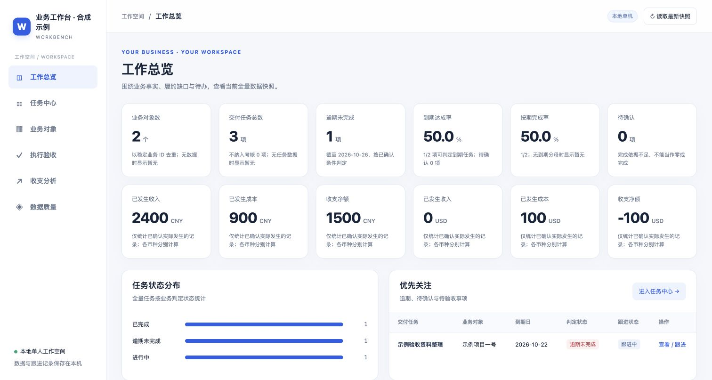

# 业务工作台生成器

根据业务目标和用户自己的表格，建立适用的业务工作台、服务台与数据看板。适合服务履约、项目交付、运营跟进和经营收支等文件驱动场景。

业务框架、字段契约、计算脚本和界面模板共用，可以接入不同模型与 Agent 宿主。核心不依赖 Codex API 或模型厂商 SDK。

**v1.1.0 · Python 3.10+ · 仅用 Python 标准库 · 不含原业务数据库或客户数据**

[下载 Skill ZIP](dist/service-workbench-builder-v1.1.0.zip) · [完整使用说明](docs/quickstart.md) · [通用提示词](AGENT_PROMPT.md) · [跨平台接入](references/platforms.md) · [验证报告](docs/validation.md)



## 它怎样工作

确认业务用途 → 提供现有文件或填写模板 → 核对字段、主键、日期与指标口径 → 校验并建立工作台 → 处理跟进与后续刷新。

没有数据时可以先生成空白工作台；缺少依据的指标显示待补或待确认，不用演示数据充当用户事实。每位用户用自己的文件创建独立数据库。

## 三种跨平台入口

| 宿主环境 | 接入方式 | 执行条件 |
|---|---|---|
| 支持目录 Skill 的 Agent | 导入本目录或 Skill ZIP，读取 [SKILL.md](SKILL.md) | 宿主具备文件读写、Python 与持久目录 |
| 支持自定义工具的 Agent / 模型 API | 注册 [工具 schema](adapters/tool.schema.json)，连接 [JSON 执行桥](scripts/agent_bridge.py) | 宿主实际执行函数、回传结果，并交付生成文件 |
| 普通聊天 / 智能体指令 | 粘贴或提供 [AGENT_PROMPT.md](AGENT_PROMPT.md) | 只有聊天能力时先形成需求、字段映射与执行方案；实际生成需要执行环境 |

豆包、DeepSeek 等模型与宿主的具体接入方向、官方文档和能力边界见[跨平台接入说明](references/platforms.md)。不能仅凭模型品牌推断文件、代码执行或安装能力。`agents/openai.yaml` 只是可选 Codex UI 元数据，其他平台可以忽略。

### 通用目录安装

在本仓库目录内执行，并把占位路径换成目标宿主实际扫描的技能根目录：

```sh
python3 scripts/install.py --skills-dir "<目标宿主的技能根目录>" --dry-run
python3 scripts/install.py --skills-dir "<目标宿主的技能根目录>"
```

安装器只复制目录，目标已存在时停止，不修改平台账号、模型配置或工具权限。Windows 可按运行环境使用 `python` 或 `py -3` 替代 `python3`。

## 需要准备什么文件

优先使用现有 CSV、TSV、Excel XLSX、扁平 JSON 或 JSONL；中文表头可通过配置映射，无需强制改名。空白模板都只有表头，按需求选择，不必全部填写。

| 模板 | 一行代表什么 | 常见用途 |
|---|---|---|
| [objects.csv](assets/input-templates/objects.csv) | 一个客户、项目、门店、设备等对象 | 对象档案、跨表关联 |
| [tasks.csv](assets/input-templates/tasks.csv) | 一项任务或具体周期的应履约义务 | 任务、交付、计划与期限 |
| [executions.csv](assets/input-templates/executions.csv) | 一次独立执行及验收结果 | 按验收数量判断履约 |
| [transactions.csv](assets/input-templates/transactions.csv) | 一笔明确日期、方向和币种的收支 | 经营收支分析 |

使用稳定业务 ID 关联，不把行号或名称相似度当主键。完整字段、日期、验收、单位和币种规则见[文件契约](references/data-contract.md)。

## 不依赖 Agent 的直接运行

运行环境需 Python 3.10+、SQLite、业务时区数据及文件读写能力。本包不自带 Python，也不会自动调用付费模型。

以下命令在仓库根目录执行。用户文件和生成数据库放在仓库之外，避免误提交业务数据。

```sh
python3 scripts/workbench.py init --output ../my-business-workspace --mode project
```

把用户文件放入该工作目录，先查看结构，再按[配置说明](references/runtime.md)编辑 `../my-business-workspace/blueprint.json`：

```sh
python3 scripts/workbench.py profile ../my-business-workspace/inputs/tasks.csv
python3 scripts/workbench.py build --config ../my-business-workspace/blueprint.json --output ../my-business-workspace/app
python3 scripts/workbench.py inspect --workspace ../my-business-workspace/app
python3 scripts/workbench.py serve --workspace ../my-business-workspace/app
```

空模板只会生成空工作台。实际数据应先核对映射、主键、关联和指标口径。浏览器需要连接 `serve` 返回的本机地址，直接双击 HTML 无法使用保存 API。

### 接入 JSON 工具

由宿主预先创建用户工作目录、保存上传文件，再运行：

```sh
python3 scripts/agent_bridge.py --workspace-root ../my-business-workspace
```

通过 stdin 输入一个 JSON，例如：

```json
{"action":"capabilities"}
```

stdout 返回一个 JSON，宿主必须检查 `ok` 后再回填模型。工具支持环境检查、初始化、文件画像、配置、生成、刷新、指标核对与私有应用打包。完整协议及 API 消息包装说明见[跨平台接入](references/platforms.md)。

## 已实现的底座能力

- 文件画像、字段/枚举映射、主键和关联校验、导入批次与错误报告。
- 任务筛选、验收数量、到期/按期判定、未知值与覆盖范围提示。
- 按币种计算已发生收支，预估与待确认金额保留在台账中单列。
- 独立保存跟进状态与备注、修改审计、CSV 导出。
- 完整快照刷新、刷新前 SQLite 备份；重复刷新不翻倍。
- 可打包当前用户应用，供宿主交付下载。

原始状态、执行验收和人工跟进分别保存。修改跟进状态不等于完成任务；上传证据不自动代表验收通过。没有可判定到期分母时不显示虚假的 100%。

## 运行范围

默认应用是运行环境中的单人工作台。团队身份、细粒度权限、公网部署、自动采集、完整派单审批与复杂周期权益，需要按实际需求另外实现和验证。

`refresh` 是所有配置来源的完整快照替换，先备份，再更新事实，保留人工跟进。增量文件应先明确合并规则，不能直接替换完整数据。

在云端或 Agent 沙箱生成时，`127.0.0.1` 属于沙箱所在机器，不是用户可直接访问的公网地址。应交付可下载应用，或使用已配置的预览/部署入口。工具生成的应用 ZIP 含当前用户数据库，与本仓库公开分享的空 Skill ZIP 分开保管。

## 验证与维护

```sh
python3 -m unittest discover -s tests -v
```

20 项本地合成测试通过，覆盖原业务引擎、JSON 工具桥、通用安装和提示词生成；另完成桌面与手机布局验证。尚未在豆包、DeepSeek 的实际账户或厂商云沙箱中进行端到端运行。[验证范围](docs/validation.md)

通用提示词由共同源文件生成，维护规则后重新运行：

```sh
python3 scripts/export_prompt.py --output AGENT_PROMPT.md
```

下载 ZIP 的 SHA-256 见 [dist/SHA256SUMS](dist/SHA256SUMS)。仓库不存放用户生成的业务数据库、原始业务文件、凭据或私人路径。
